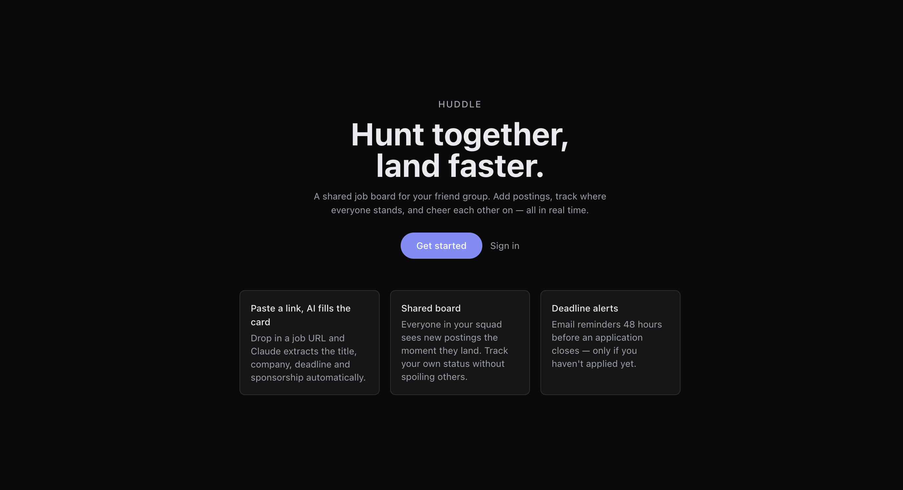
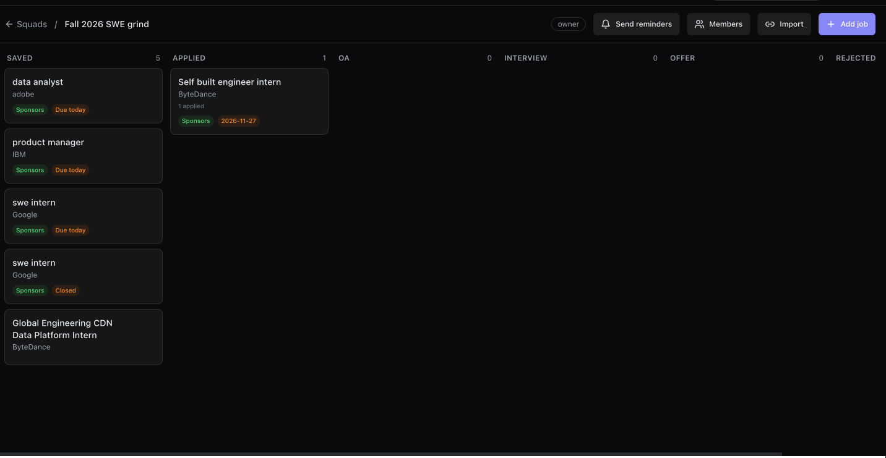

# Huddle

**Live:** https://huddle.app.space

A shared job board for small groups. Paste a job link, AI fills in the card,
and everyone tracks their own progress on the same postings, in real time.





## Why I built this

I'm a first-year M.S. Data Science student at Fordham, applying to summer 2027
internships across SWE, ML, data science and product. My friends and I were
job-hunting at the same time, and good leads kept getting buried in group chats.
Deadlines lived in my head, and copying every posting into a spreadsheet took longer
than applying.

I wanted one place where a squad shares leads but each person keeps their own
pipeline — where I can see a friend already reached the OA for a role and ask them about it.

## What it does

- **Import from link or text:** paste a Greenhouse, Lever or careers-page URL and Claude
  extracts title, company, location, deadline, sponsorship notes and key requirements.
  Blocked pages (LinkedIn, Workday) fall back to pasting the job description as text.
- **Shared postings, personal progress:** Saved → Applied → OA → Interview →
  Offer / Rejected. Moving your card doesn't move anyone else's. Cards show squad
  progress ("2 applied · 1 OA").
- **Team tracker and comments:** each job shows every member's status, plus threaded comments.
- **Deadline reminders:** a daily cron job emails members still at Saved 48 hours
  before a deadline. Each job is reminded once — no duplicates.
- **Roles:** owners manage the squad, members track, viewers read only.
  Every write is checked on the server, not just hidden in the UI.
- **Invite codes:** share a 6-character code to join a squad.

## Built on DeepSpace

[DeepSpace](https://deepspace.dev): Cloudflare Workers + Durable Objects, with auth,
RBAC, realtime records, server actions and cron in one SDK.

| Piece | Used for |
|---|---|
| Firecrawl (`firecrawl/scrape`) | Reading a single job posting (scrape, not crawl: one page, billed once) |
| Anthropic (`anthropic/chat-completion`, Claude Haiku) | Extracting structured JSON from the page |
| Email (`email/send`) + cron | 48-hour deadline reminders, no sender setup or secrets |
| Auth, `collaboratorsField`, `useQuery`, server actions, `useUserLookup` | Sign-in, read gating, live updates, permission checks, member names |

## Key tradeoffs

- **All squad writes go through server actions.** `collaboratorsField` gates reads
  but not creates, and schema roles are app-wide, not per squad. So jobs, comments,
  status and role changes are checked in actions (`getMembership` + role).
- **Membership is stored twice** (on the squad for read gating, and in `squadMembers`
  for roles), with no transactions, so join and leave roll back if the second write
  fails. I chose a `listMembers` action over a third synced copy: the member list isn't
  live, but there's less drift.
- **Per-person status lives in `applications`**, not on the job. This also simplified
  permissions, since users only write their own status records.
- **Reminders are best-effort (at most once).** `remindedAt` prevents duplicates,
  but a failed send isn't retried.
- **Import depends on the page being public.** The text-paste fallback covers the rest.

## Known gaps and next steps

- Job reads are not yet scoped to squad members (any authenticated user can query jobs by squadId)
- Live updates for the member list
- Retrying failed reminder emails
- Invites by email instead of code
- Resume-fit scoring for each posting
- Automated tests for the permission rules

## Run it locally

```bash
npm install
npx deepspace dev
```

Open `http://localhost:5173`.

```bash
npx deepspace deploy
```

## Project structure

```
src/
  actions/index.ts          # Server actions: all permission checks live here
  schemas/                  # Collection schemas
  cron.ts                   # Deadline reminders
  pages/
    index.tsx               # Landing page
    (app)/sign-in.tsx
    (app)/(protected)/dashboard.tsx
    (app)/(protected)/squad/[squadId].tsx   # Board, import, detail panel, members
```
